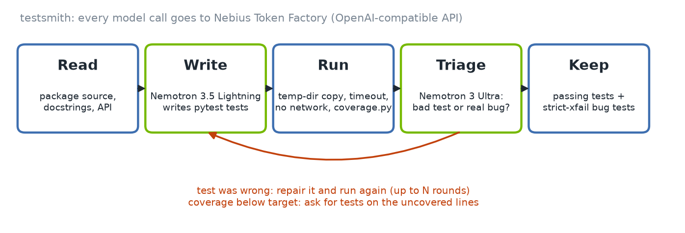

# testsmith

**A coding agent that writes pytest tests for your Python package, runs them in a sandbox, repairs the tests that are wrong, and reports the bugs that are real. Powered by NVIDIA Nemotron on Nebius Token Factory.**

Most automatic test writers share one flaw: when a test fails, the tool "fixes" it by changing the assertion until it matches whatever the code does. That turns every bug into a passing test. testsmith treats a failing test as a question with two possible answers, *the test is wrong* or *the code is wrong*, and only accepts the second when it can show evidence.



```
$ testsmith examples/buggy_inventory --replay examples/replay/buggy_inventory.json
coverage 52.1% -> 100.0% | 16 passing tests kept | 3 likely bugs
  BUG Inventory.remove (buggy_inventory/stock.py:62)
  BUG needs_reorder (buggy_inventory/stock.py:8)
  BUG order_total_cents (buggy_inventory/pricing.py:37)
```

Full output: [docs/sample-report.md](docs/sample-report.md) (from the recorded offline run, see [Offline replay](#offline-replay-no-key-needed)).

## What it does

Given a package path (and optionally `--module` / `--function`), testsmith:

1. **Reads the code**: source with line numbers, signatures and docstrings, and runs the existing tests to get baseline line coverage.
2. **Writes tests** with Nemotron 3.5 Lightning. The prompt asks for tests of the *contract* (docstrings, names, types), with boundaries, error types and money rounding called out.
3. **Runs them** on a temp-dir copy of the package in a fresh subprocess: scrubbed environment (your API key never reaches model-written code), whole-run timeout that kills the process group, a per-test time limit, CPU and file-size rlimits, outbound network blocked, coverage.py on.
4. **Triages every failure.** Failures that can only be the test's fault (does not import, wrong arguments, undefined names) are settled by rule. Everything else goes to Nemotron 3 Ultra, which must return a verdict per test as JSON: `test_wrong` with a repaired test, or `real_bug` with the quoted promise the code breaks, expected vs actual, and a standalone repro script.
5. **Accepts a bug only with evidence**: the judge's confidence clears a bar (0.6 by default), it quotes the promise, the test actually calls package code, and the failure repeats identically on an immediate rerun. Weak verdicts are dropped and listed as unconfirmed suspicions, never reported as bugs.
6. **Repairs and repeats** up to `--rounds` times (default 3). When nothing new fails and coverage is below `--target-coverage` (default 90%), it sends the uncovered line numbers back and asks for more tests.
7. **Keeps only what earned its place**: passing tests, plus bug-exposing tests marked `@pytest.mark.xfail(strict=True, reason=...)`. The emitted file is green today and starts failing (XPASS) the day the bug is fixed, which tells you to remove the marker.

Output (in `--out`, default `./testsmith-out/`):

- `test_<package>_testsmith.py`: the verified test file.
- `report.md`: coverage before/after, each bug with the broken promise, the failing assertion, the test as a minimal repro and the output of the repro script run in the sandbox, a per-round log, and a per-call model usage table (tokens, latency, retries, cost).
- `run.json`: the same data, machine readable.

## Quick start

Python 3.10+.

```bash
python3 -m venv .venv && source .venv/bin/activate
pip install -e .
cp .env.example .env          # paste your Token Factory key into NEBIUS_API_KEY
testsmith --check             # verifies the key and that the Nemotron models are served
testsmith examples/buggy_inventory
```

Useful flags:

```bash
testsmith path/to/pkg --module pricing --function order_total_cents
testsmith path/to/pkg --rounds 5 --target-coverage 95 --out runs/pkg
testsmith path/to/pkg --tests path/to/tests      # existing suite for the baseline (default: ./tests next to the package)
testsmith path/to/pkg --model nvidia/Nemotron-3_5-Lightning --judge-model nvidia/Nemotron-3_5-Lightning
```

Run the emitted tests yourself (the package must be importable):

```bash
cd examples && python -m pytest ../testsmith-out/test_buggy_inventory_testsmith.py
```

### Offline replay (no key needed)

```bash
testsmith examples/buggy_inventory --replay examples/replay/buggy_inventory.json
```

`--replay` answers each model call from a recorded script instead of the API. Everything else is real: the sandboxed pytest runs, coverage, the triage rules, the rerun check and the repro scripts. The report is labelled as a replay. This is how the test suite and [docs/sample-report.md](docs/sample-report.md) were produced, and it lets anyone try the tool before creating an account.

## How Nemotron and Token Factory are used

Every model call is a runtime call to the **Nebius Token Factory** inference API through its OpenAI-compatible endpoint, using the standard `openai` Python client with `base_url` set ([testsmith/llm.py](testsmith/llm.py)). Two NVIDIA Nemotron open models split the work:

| Step | Model | Why |
|---|---|---|
| Write tests, write coverage follow-ups, fix files that do not import | `nvidia/Nemotron-3_5-Lightning` | Fast, low-cost MoE (30B total, 3B active, 1M context). Writing tests is high-volume and a mistake here is cheap because the sandbox and the judge catch it. |
| Triage: "bad test or real bug?", repaired tests, repro scripts | `nvidia/Nemotron-3-Ultra-550b-a55b` | The flagship reasoning model (550B total, 55B active). This is the one decision that must be right: a wrong call either hides a bug or files a false one. |

Both are configurable (`TESTSMITH_MODEL`, `TESTSMITH_JUDGE_MODEL`). If the judge model is not served at the endpoint, testsmith falls back to the writer model and says so in the report.

Where Token Factory fits the workflow:

- **One client for both tiers.** The OpenAI-compatible API means the writer and the judge are the same code path with a different model id, so mixing a small and a large Nemotron per step costs nothing in complexity.
- **Long context.** Lightning's 1M-token context lets testsmith send whole modules with line numbers, which is what makes the "tests for the uncovered lines" step work.
- **Model discovery.** `testsmith --check` calls `GET /v1/models` and confirms both ids before a run.
- **Accounting.** Every call is logged with prompt and completion tokens (from the API's `usage` field), latency and retry count, and priced where Nebius publishes a price. Retries for rate limits, timeouts and 5xx errors are counted per call.
- **Reasoning output.** Nemotron can emit `<think>` spans; the extraction layer ([testsmith/extract.py](testsmith/extract.py)) strips them, picks the right fenced block, repairs common JSON slips (trailing commas), and asks once more with a corrective message if a reply is still unusable.

### Sources for the endpoint and model ids

- Base URL `https://api.tokenfactory.nebius.com/v1/` and the `NEBIUS_API_KEY` convention: Token Factory quickstart, <https://docs.tokenfactory.nebius.com/quickstart>, and "List of models", <https://docs.tokenfactory.nebius.com/api-reference/examples/list-of-models>.
- `nvidia/Nemotron-3_5-Lightning` and `nvidia/Nemotron-3-Ultra-550b-a55b`: the Nemotron table and notebook in the official cookbook, <https://github.com/nebius/token-factory-cookbook/blob/main/models/nemotron/README.md> and `models/nemotron/run_nemotron.ipynb`; Ultra's model card and price ($1.00 / 1M input, $3.00 / 1M output) in `models/nemotron/nemotron3-ultra-550b-a55b.md`.
- Why not Nemotron 3 Super or Nano: the "Model Deprecations: November 2026" notice, <https://docs.tokenfactory.nebius.com/model-deprecations-november-2026>, removes `nvidia/nemotron-3-super-120b-a12b` and `nvidia/NVIDIA-Nemotron-3-Nano-30B-A3B` from Serverless on November 9, 2026 and names `nvidia/Nemotron-3_5-Lightning` as a replacement. Judging runs in December, so the defaults avoid both.

All of the above was read on October 28, 2026. Run `testsmith --check` to confirm what your key can reach today.

## The demo package

[examples/buggy_inventory/](examples/buggy_inventory/) is a small warehouse library (SKU validation, stock movements, reorder checks, bulk discounts, tax) with a thin hand-written test in [examples/tests/](examples/tests/). Three realistic bugs are planted in it; the answer key is in [examples/README.md](examples/README.md) if you want to check testsmith's work.

## How it meets the hackathon requirements

| Requirement | Where |
|---|---|
| Coding and Agentic Engineering track: an agent that writes, runs and tests code | The whole tool: write, run, triage, repair, repeat |
| Runtime call to the Nebius Token Factory inference API | [testsmith/llm.py](testsmith/llm.py), `NebiusLLM.chat` |
| At least one NVIDIA open model | Nemotron 3.5 Lightning (writer) and Nemotron 3 Ultra (judge) |
| Open source license | [LICENSE](LICENSE) (MIT) |
| README with setup and how Nemotron / Token Factory are used | This file |

## Tests

```bash
pip install -e .
python -m pytest
```

87 tests cover the extraction layer, configuration, the real HTTP client against a local OpenAI-compatible stub server (retries, 404 handling, usage, model listing), the sandbox (isolation from the original files, network block, secret scrubbing, per-test and whole-run timeouts, every pytest status), the classifier rules and guards, the test-file editor, the report writer, the CLI, and the full agent loop: on the demo package, through the real client over HTTP, and through each branch (unrunnable file, unusable reply, judge fallback, weak verdict, repeated bad repairs, flaky failure, focus flags).

## Tech stack

Python 3.10+, `openai` client (OpenAI-compatible Token Factory API), pytest, coverage.py, the standard library for everything else (sandbox, JUnit XML parsing, AST editing). NVIDIA Nemotron 3.5 Lightning and Nemotron 3 Ultra on Nebius Token Factory. matplotlib only for the figures in `docs/` (`pip install -e .[figures]`, then `python scripts/render_figures.py docs/sample-run/run.json docs/sample-terminal.txt`).

## Limits

- The network block and rlimits stop honest mistakes, not hostile code. Run testsmith on code you would run yourself.
- Python packages only; the target's own dependencies must be installed in the same environment.
- "Likely bug" means the evidence bar was met, not proof. Each finding links the promise, the failing assertion and a repro so a human can confirm it in under a minute.

## License

MIT, see [LICENSE](LICENSE).
